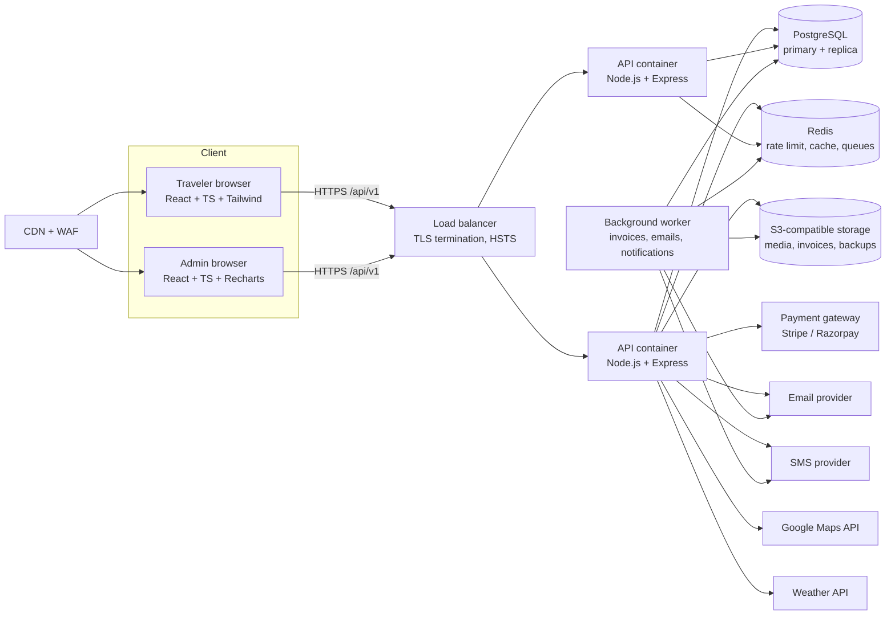
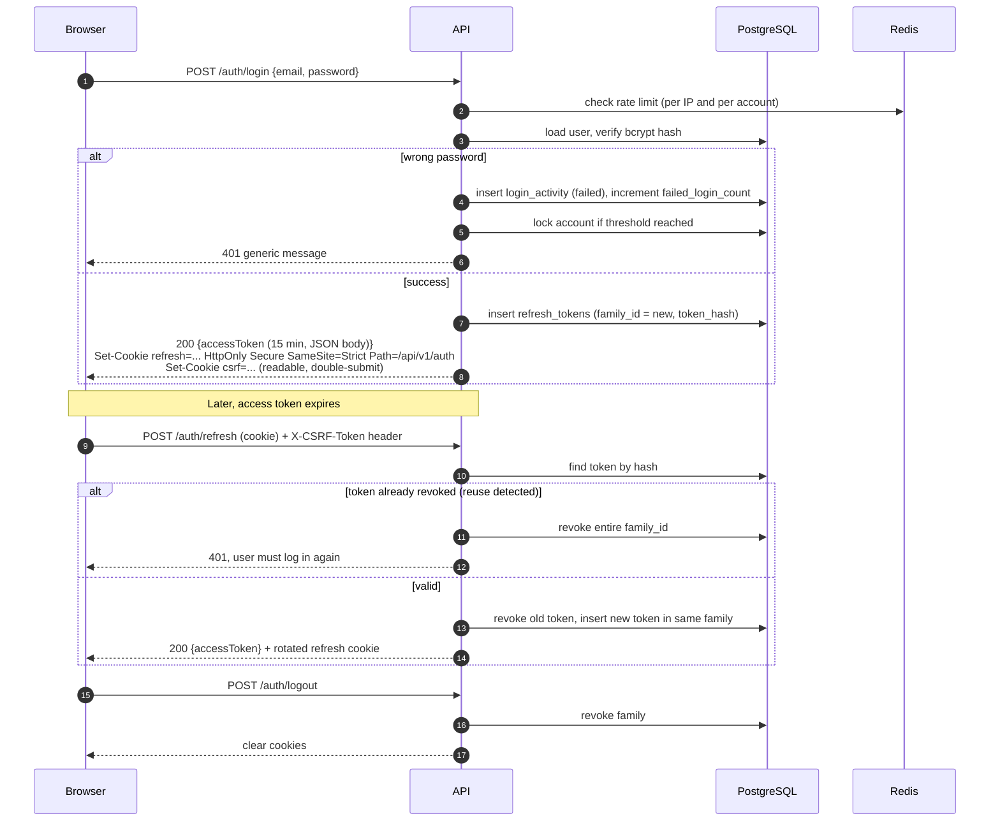
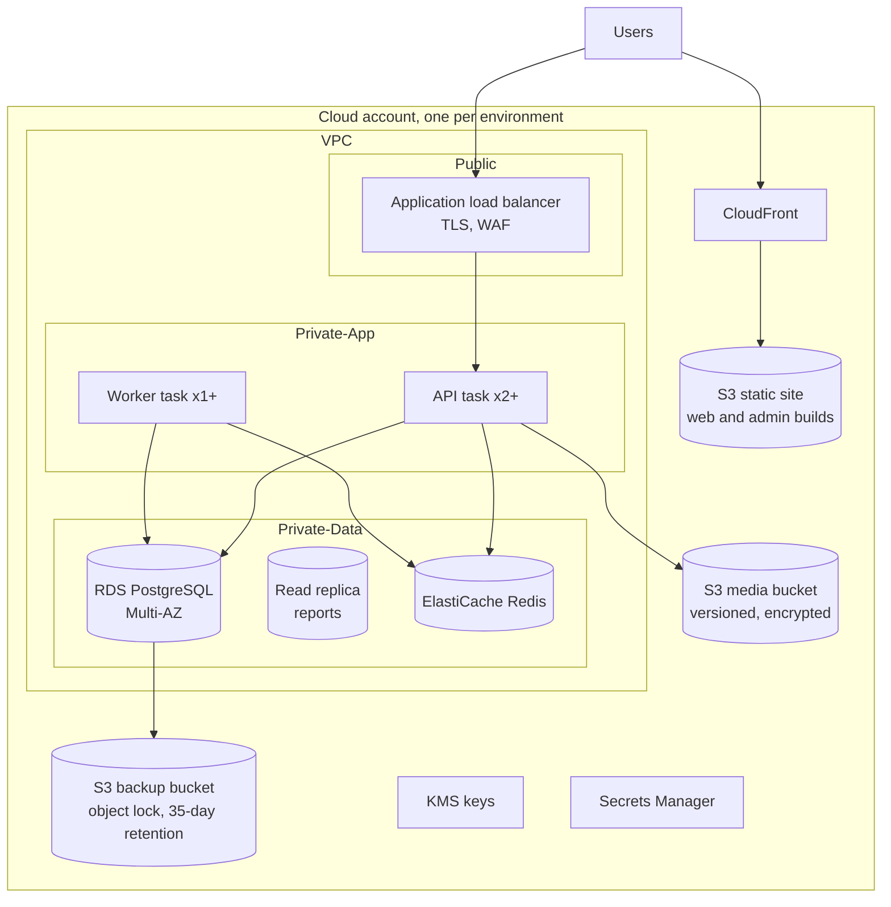
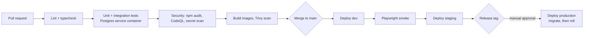

# Travel & Tourism Booking Platform: Architecture

## 1. System Architecture



Key decisions:

- **Modular monolith, not microservices.** One deployable API split into bounded modules (auth, catalog, booking, payments, reviews, and so on). This keeps transactions simple, especially for seat inventory and payments. Modules talk through service interfaces, so one can be extracted later if load demands it.
- **Stateless API containers** behind a load balancer. Session state lives in JWTs and Redis, not in process memory.
- **Background worker** shares the same codebase and image, started with a different command. It runs invoice PDF generation, email and SMS sending, and scheduled jobs (expiring unpaid bookings, reminders).
- **Redis** is used for rate limiting, short-lived caches, and the job queue (BullMQ). It is not the system of record.

## 2. Technology Choices

| Concern | Choice | Notes |
|---|---|---|
| Frontend | React 18+ (latest stable), TypeScript, Vite | SPA for the app; SSR can be added later for SEO on package pages |
| Styling | Tailwind CSS | Design tokens in `tailwind.config.ts` |
| Animation | Framer Motion | Respect `prefers-reduced-motion` |
| Charts | Recharts | Admin dashboard only |
| State | Redux Toolkit + RTK Query | RTK Query handles caching and token refresh for API calls |
| Maps | Google Maps JavaScript API | Destination and package pins |
| Backend | Node.js LTS, Express, TypeScript | |
| Validation | Zod | Shared schemas in `packages/shared` |
| ORM | Prisma | Migrations via `prisma migrate` |
| Database | PostgreSQL 16 | Full-text search on packages, JSONB for itinerary |
| Auth | JWT access token + rotating refresh token | See section 5 |
| Password hashing | bcrypt, cost factor 12 | |
| Storage | AWS S3 or any S3-compatible store (MinIO locally) | Presigned URLs for uploads and downloads |
| API docs | swagger-jsdoc + swagger-ui-express | Served at `/api/docs`, disabled in production by default |
| Logging | pino (JSON logs) | Request ID on every log line |
| Testing | Vitest, Supertest, Playwright | |
| Containers | Docker, Docker Compose for local | |

## 3. Clean Architecture (Backend)

Dependencies point inward. Domain code imports nothing from Express, Prisma, or AWS.

```
Interface (HTTP)  ->  Application (use cases / services)  ->  Domain (entities, rules)
                                    |
                                    v
                      Infrastructure (Prisma repos, S3, payment, email, SMS)
```

- **Domain**: entities, value objects (`Money`, `DateRange`, `BookingStatus`), domain errors, and invariants such as "seats booked may not exceed capacity".
- **Application**: services that orchestrate use cases (`BookingService.createBooking`, `AuthService.login`). They depend on repository and gateway interfaces, not implementations.
- **Infrastructure**: Prisma repository implementations, S3 adapter, payment adapter per provider, mail and SMS adapters. Each implements an interface defined in the application layer.
- **Interface**: Express routers, controllers (thin: parse, call service, map result), middleware, Swagger annotations.

SOLID mapping:

- **S**: one service per module; controllers do HTTP only.
- **O**: payment and notification providers are added as new adapters, with no change to booking code.
- **L**: all repository implementations honor the same interface, so an in-memory fake can replace Prisma in unit tests.
- **I**: small interfaces (`PackageReader`, `PackageWriter`) rather than one god repository.
- **D**: services receive dependencies through constructor injection (tsyringe or a manual composition root in `src/app.ts`).

## 4. Folder Structure

### 4.1 Repository root

```
travel-platform/
├── apps/
│   ├── web/                    # React customer site + account area
│   └── admin/                  # React admin dashboard (separate build, same design system)
├── services/
│   └── api/                    # Express API + worker
├── packages/
│   └── shared/                 # Zod schemas, shared TS types, constants, error codes
├── database/
│   ├── prisma/
│   │   ├── schema.prisma
│   │   ├── migrations/         # generated by prisma migrate
│   │   └── seed/               # roles, permissions, demo destinations and packages
│   ├── schema.sql              # reference DDL (see docs/DATABASE.md)
│   └── scripts/
│       ├── backup.sh           # nightly pg_dump to S3, encrypted
│       └── restore-drill.sh    # restores latest backup into a scratch DB
├── infra/
│   ├── docker/
│   │   ├── web.Dockerfile
│   │   ├── api.Dockerfile
│   │   └── nginx/              # static hosting + security headers for the SPA
│   ├── compose/
│   │   ├── docker-compose.yml        # local: postgres, redis, minio, api, web
│   │   └── docker-compose.prod.yml   # single-host reference deployment
│   └── terraform/              # cloud resources (VPC, RDS, ElastiCache, S3, ECS)
├── .github/
│   └── workflows/
│       ├── ci.yml              # lint, typecheck, unit + integration tests, build images
│       ├── security.yml        # npm audit, Trivy image scan, CodeQL, secret scan
│       └── deploy.yml          # staging on main, production on tag with manual approval
├── docs/
│   ├── ARCHITECTURE.md
│   ├── DATABASE.md
│   ├── API.md
│   └── ROADMAP.md
├── .env.example
├── docker-compose.yml          # symlink or copy of infra/compose/docker-compose.yml
└── README.md
```

### 4.2 Backend (`services/api`)

```
services/api/
├── src/
│   ├── app.ts                  # Express app: helmet, cors, parsers, routes, error handler
│   ├── server.ts               # HTTP bootstrap, graceful shutdown
│   ├── worker.ts               # job worker bootstrap
│   ├── config/
│   │   ├── env.ts              # Zod-validated environment, fails fast on bad config
│   │   └── swagger.ts
│   ├── shared/
│   │   ├── errors/             # AppError, NotFound, Conflict, Forbidden, Validation
│   │   ├── logger/             # pino setup, request-id propagation
│   │   ├── security/           # bcrypt wrapper, field encryption, token hashing
│   │   ├── pagination/
│   │   └── types/
│   ├── middleware/
│   │   ├── authenticate.ts     # verifies access token
│   │   ├── authorize.ts        # RBAC: authorize('packages:write')
│   │   ├── validate.ts         # Zod validation for body, query, params
│   │   ├── csrf.ts             # double-submit token check on cookie-authenticated routes
│   │   ├── rateLimit.ts        # per-route policies (login, register, booking, global)
│   │   ├── auditLog.ts         # writes AuditLogs for admin mutations
│   │   └── errorHandler.ts
│   ├── modules/
│   │   ├── auth/
│   │   │   ├── auth.routes.ts
│   │   │   ├── auth.controller.ts
│   │   │   ├── auth.service.ts
│   │   │   ├── auth.schemas.ts
│   │   │   └── auth.service.test.ts
│   │   ├── users/              # profile, admin user management, role assignment
│   │   ├── roles/              # roles and permissions (role management)
│   │   ├── destinations/
│   │   ├── packages/           # catalog, departures, media
│   │   ├── search/            # filters, sort, facets
│   │   ├── bookings/           # seat inventory, status machine, cancellations
│   │   ├── payments/           # gateway adapters, webhooks, refunds
│   │   ├── invoices/
│   │   ├── reviews/
│   │   ├── wishlist/
│   │   ├── notifications/      # in-app center + email/SMS dispatch
│   │   ├── blogs/
│   │   ├── banners/
│   │   ├── contact/
│   │   ├── analytics/          # KPI and report queries
│   │   ├── coupons/            # later phase
│   │   ├── referrals/          # later phase
│   │   ├── loyalty/            # later phase
│   │   ├── insurance/          # later phase
│   │   ├── recommendations/    # later phase
│   │   └── chat/               # later phase
│   ├── infrastructure/
│   │   ├── database/           # Prisma client, transaction helper
│   │   ├── repositories/       # Prisma implementations of module repository interfaces
│   │   ├── storage/            # S3 adapter (presigned URLs)
│   │   ├── payments/           # stripe.adapter.ts, razorpay.adapter.ts
│   │   ├── email/
│   │   ├── sms/
│   │   ├── maps/
│   │   ├── weather/
│   │   └── queue/              # BullMQ setup
│   └── jobs/
│       ├── expireUnpaidBookings.job.ts
│       ├── sendBookingReminders.job.ts
│       └── generateInvoice.job.ts
├── tests/
│   ├── unit/
│   ├── integration/            # Supertest against a Postgres test container
│   └── contract/               # OpenAPI validation
├── Dockerfile                  # or infra/docker/api.Dockerfile
├── package.json
└── tsconfig.json
```

Each module follows the same layout: `routes -> controller -> service -> repository interface`. Repository interfaces live in the module; Prisma implementations live in `infrastructure/repositories`.

### 4.3 Frontend (`apps/web`)

```
apps/web/
├── src/
│   ├── main.tsx
│   ├── app/
│   │   ├── App.tsx
│   │   ├── router.tsx          # React Router, lazy routes
│   │   ├── store.ts            # Redux store
│   │   └── providers.tsx       # i18n, theme, toast, query client
│   ├── api/
│   │   ├── baseApi.ts          # RTK Query base, attaches access token, refreshes on 401
│   │   └── endpoints/          # one file per domain, generated types from OpenAPI
│   ├── features/
│   │   ├── auth/               # login, register, forgot password, session slice
│   │   ├── home/               # hero, destinations, trending, testimonials, counters, FAQ
│   │   ├── destinations/
│   │   ├── packages/           # list, detail, itinerary, availability calendar
│   │   ├── search/             # filter panel, URL-synced state
│   │   ├── booking/            # checkout, payment step, confirmation
│   │   ├── bookings/           # history, booking detail, invoice download, cancellation
│   │   ├── reviews/
│   │   ├── wishlist/
│   │   ├── profile/
│   │   ├── notifications/      # notification center
│   │   ├── blogs/
│   │   ├── contact/
│   │   └── maps/               # interactive destination map
│   ├── admin/
│   │   ├── dashboard/          # KPI cards, charts
│   │   ├── packages/
│   │   ├── bookings/
│   │   ├── customers/
│   │   ├── reviews/
│   │   ├── destinations/
│   │   ├── banners/
│   │   ├── reports/
│   │   ├── users/
│   │   └── roles/
│   ├── components/
│   │   ├── ui/                 # Button, Input, Card, Modal, Skeleton, Badge
│   │   ├── motion/             # FadeIn, ScrollReveal, Counter, HoverLift
│   │   ├── layout/             # NavBar, Footer, AdminShell
│   │   └── feedback/           # Toast, ErrorBoundary, EmptyState
│   ├── guards/
│   │   ├── RequireAuth.tsx
│   │   └── RequireRole.tsx     # protected routes, UI-level only; API is the real gate
│   ├── hooks/
│   ├── i18n/                   # locale files, one per language
│   ├── lib/
│   │   ├── format.ts           # currency, date, number formatting by locale
│   │   └── sanitize.ts         # DOMPurify wrapper for rich text
│   ├── styles/
│   └── types/
├── public/
├── index.html
├── tailwind.config.ts
├── vite.config.ts
└── package.json
```

### 4.4 Database (`database/`)

See [DATABASE.md](DATABASE.md) and [schema.sql](../database/schema.sql). The Prisma schema is the source of truth for migrations. `schema.sql` is the reviewed reference DDL and is used to verify the Prisma output.

### 4.5 Docker and CI/CD

Covered in sections 8 and 9.

## 5. Authentication Flow



Rules:

- Access token: JWT, RS256 or EdDSA, 15-minute lifetime, claims `sub`, `role`, `perms`, `iat`, `exp`. Held in memory in the frontend, never in localStorage.
- Refresh token: opaque random 256-bit value, 7-day lifetime, rotated on every use. Only the SHA-256 hash is stored.
- Reuse of a revoked refresh token revokes the whole family (theft detection).
- Password reset and email verification use single-use tokens with 30-minute and 24-hour lifetimes, stored hashed.
- Lockout: 5 failed attempts in 15 minutes locks the account for 15 minutes; an alert is raised at 20 failures across accounts from one IP.

## 6. Security Architecture

| Threat | Control |
|---|---|
| Transport interception | TLS 1.2+ at load balancer, HSTS (max-age 1 year, includeSubDomains, preload), HTTP to HTTPS redirect |
| XSS | React escapes output by default; DOMPurify on any HTML from blogs or admin rich text; strict CSP (`script-src 'self'`, no inline scripts); `HttpOnly` cookies |
| CSRF | Refresh cookie is `SameSite=Strict` and path-scoped; state-changing cookie-authenticated routes require `X-CSRF-Token` matching the csrf cookie (double-submit); CORS allowlist with credentials |
| SQL injection | Prisma parameterized queries only; any raw SQL uses `$queryRaw` tagged templates; a lint rule bans string-concatenated `$queryRawUnsafe` |
| Input validation | Zod schema per endpoint for body, query, and params; unknown keys rejected; body size limit 100 KB (uploads go to S3 via presigned URL) |
| Request sanitization | Strip control characters and trim strings; `hpp` for parameter pollution; reject NUL bytes |
| Security headers | Helmet with CSP, `X-Content-Type-Options`, `Referrer-Policy: strict-origin-when-cross-origin`, `Permissions-Policy` restricting camera and microphone |
| CORS | Explicit origin allowlist from env; no wildcard with credentials |
| Rate limiting | Global 300 req/min per IP; login 10/min per IP and 5/min per account; register 5/hour per IP; booking creation 20/min per user; Redis-backed store so limits hold across containers |
| Brute force and credential stuffing | Account lockout, generic error messages, bcrypt cost 12, failed-login detection (section 6.1) |
| Broken access control | RBAC enforced in API middleware on every route (`authorize('bookings:read:any')`); object-level checks in services (a customer may read only their own bookings); frontend guards are UX only |
| Sensitive data at rest | Field-level AES-256-GCM for phone numbers and any future personal fields; key in cloud KMS, envelope encryption, key ID stored with ciphertext to allow rotation; database volume encryption |
| Secrets | Environment variables injected by the platform secret manager; no secrets in images or the repo; secret scanning in CI |
| Dependency and image risk | `npm audit` and Trivy in CI; Dependabot; pinned base images by digest |
| Error leakage | Production errors return a generic message plus request ID; stack traces only in logs |
| Payments | Card data never touches our servers (gateway hosted fields or redirect); webhooks verified by signature and idempotency key; amounts recomputed server-side, never trusted from the client |

Data the platform will not collect or store: government ID numbers (Aadhaar, PAN, passport, driver's license), full card numbers, and patient records. Where a booking needs traveler identity documents, those are handled by the airline or insurer, not stored here. This is a stated policy, not only an implementation choice.

### 6.1 Monitoring

- **Audit logs**: every admin mutation and every role or permission change writes an `audit_logs` row with actor, action, entity, IP, and before/after metadata. The table is append-only at the DB grant level (`REVOKE UPDATE, DELETE`).
- **Login activity**: every login attempt, success or failure, writes `login_activity`.
- **Failed-login detection**: a scheduled job flags IPs with more than 20 failures in 10 minutes and accounts with more than 10 failures in 1 hour, creating a notification to the Owner role and an alert to the on-call channel.
- **Metrics and alerts**: Prometheus metrics (request rate, latency, error rate, DB pool usage, queue depth); Grafana dashboards; alerts on 5xx rate, p95 latency, and failed webhook count.

## 7. Deployment Architecture



Environments: `local` (Docker Compose), `dev` (auto-deploy from `main`), `staging` (production-like data, release candidates), `production` (tagged releases with manual approval).

Backup strategy:

- RDS automated backups with point-in-time recovery, 14-day retention.
- Nightly logical dump (`pg_dump -Fc`) to the backup bucket, encrypted, with object lock.
- Weekly restore drill: `restore-drill.sh` restores the latest dump into a scratch instance and runs row-count and smoke-query checks. A failed drill is a P2 incident.
- Targets: RPO 5 minutes (PITR), RTO 1 hour.

Migrations: `prisma migrate deploy` runs as a separate one-off ECS task before the new API version rolls out. Migrations are additive first (expand), with a later release removing old columns (contract). Destructive migrations require a reviewed plan.

## 8. Docker Configuration

`services/api/Dockerfile` (multi-stage, non-root, production dependencies only):

```dockerfile
# syntax=docker/dockerfile:1
FROM node:20-alpine AS deps
WORKDIR /app
COPY package*.json ./
RUN npm ci

FROM node:20-alpine AS build
WORKDIR /app
COPY --from=deps /app/node_modules ./node_modules
COPY . .
RUN npx prisma generate && npm run build

FROM node:20-alpine AS runtime
ENV NODE_ENV=production
WORKDIR /app
RUN addgroup -S app && adduser -S app -G app
COPY --from=build --chown=app:app /app/dist ./dist
COPY --from=build --chown=app:app /app/node_modules ./node_modules
COPY --from=build --chown=app:app /app/prisma ./prisma
USER app
EXPOSE 4000
HEALTHCHECK --interval=30s --timeout=3s CMD wget -qO- http://127.0.0.1:4000/health || exit 1
CMD ["node", "dist/server.js"]
```

`infra/compose/docker-compose.yml` (local):

```yaml
services:
  postgres:
    image: postgres:16-alpine
    environment:
      POSTGRES_DB: travel
      POSTGRES_USER: travel
      POSTGRES_PASSWORD: ${POSTGRES_PASSWORD:?set in .env}
    volumes: [pgdata:/var/lib/postgresql/data]
    ports: ["5432:5432"]
  redis:
    image: redis:7-alpine
    command: ["redis-server", "--appendonly", "yes"]
  minio:
    image: minio/minio
    command: server /data --console-address ":9001"
    environment:
      MINIO_ROOT_USER: ${MINIO_USER:?}
      MINIO_ROOT_PASSWORD: ${MINIO_PASSWORD:?}
    ports: ["9000:9000", "9001:9001"]
  api:
    build: { context: ../../services/api, dockerfile: Dockerfile }
    env_file: ../../.env
    depends_on: [postgres, redis, minio]
    ports: ["4000:4000"]
  web:
    build: { context: ../../apps/web, dockerfile: ../../infra/docker/web.Dockerfile }
    ports: ["8080:80"]
volumes:
  pgdata:
```

Production containers run read-only root filesystems, drop all Linux capabilities, and set `no-new-privileges`.

## 9. CI/CD



Pipeline rules:

- Every PR must pass all gates before merge; branch protection requires one review.
- Images are tagged with the commit SHA and pushed to the registry; deploys reference the digest, not a mutable tag.
- Rolling deploy with health checks; automatic rollback if the health check fails within 5 minutes.
- Feature flags (env-driven) gate unfinished modules so they can merge without being exposed.

## 10. Observability and Operations

- Health endpoints: `/health` (liveness), `/ready` (checks DB and Redis).
- Request ID (`X-Request-Id`) generated or accepted, returned in responses, and logged.
- Error tracking via Sentry on both frontend and API.
- Runbooks for: database failover, payment webhook backlog, S3 outage (media falls back to placeholder), email provider outage (notifications queued and retried with backoff).

## 11. Decisions Needed Before Build

1. **Payment provider**: Stripe, Razorpay, or both. This determines the adapter work in Phase 4.
2. **Cloud provider**: AWS is assumed (RDS, ECS, S3, KMS). Change this and the Terraform modules change.
3. **Languages for multi-language support**: which locales at launch. Content translation tables are included in the design.
4. **Currency**: single currency, or multi-currency with conversion. The schema stores amounts in minor units with a currency code on each record.
5. **Google Maps, weather, email, and SMS accounts**: who owns them and the budget for usage.
6. **Scope of "AI Travel Recommendation Engine"**: rules-based ranking first, or a model-backed service. Recommended: rules-based first.
7. **Insurance module**: this needs a licensed insurance partner. The platform only integrates with a partner's API and does not underwrite.
