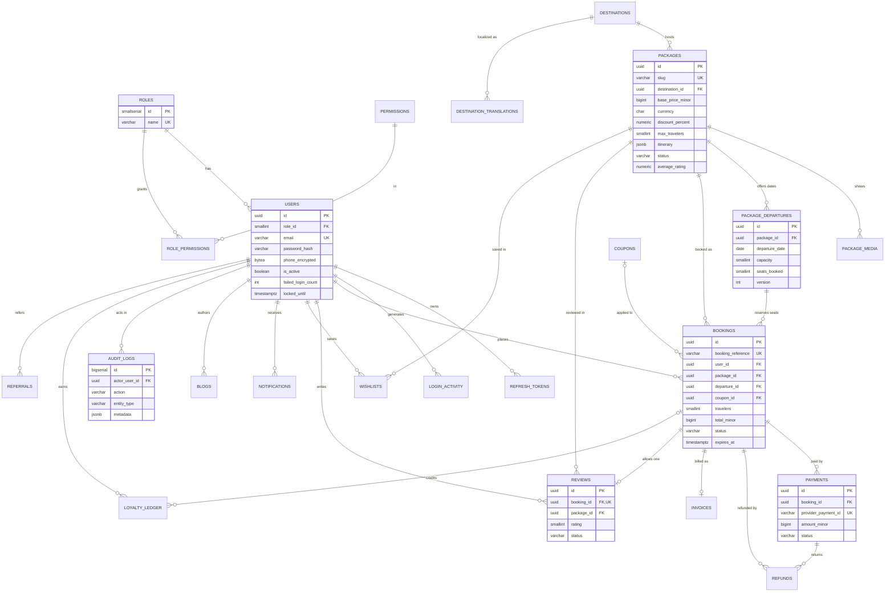

# Database Design

The reference DDL is in [database/schema.sql](../database/schema.sql). The Prisma schema mirrors it and is the migration source of truth.

## 1. ER Diagram

Entities in the diagram but not drawn with every relation for readability: `NOTIFICATIONS`, `BLOGS`, `BANNERS`, `CONTACT_MESSAGES`, `INVOICES`, `REFUNDS`, `WISHLISTS`, `LOGIN_ACTIVITY`, `REFRESH_TOKENS`, `PAYMENT_WEBHOOK_EVENTS`, `COUPONS`, `REFERRALS`, `LOYALTY_LEDGER`. All are defined in `schema.sql`.

## 2. Key Design Decisions

### Seat inventory and real-time availability

- Inventory lives on `package_departures` (one row per package and date), not computed from bookings. This makes availability a single-row read.
- `seats_booked` is constrained to `0..capacity` in the database, so an overbooking bug fails loudly instead of silently.
- Booking creation runs in one transaction:
  1. `SELECT ... FROM package_departures WHERE id = $1 FOR UPDATE`
  2. Check `seats_booked + travelers <= capacity`
  3. Increment `seats_booked` and insert the `PENDING_PAYMENT` booking with `expires_at = now() + 15 minutes`
- A job releases seats for `PENDING_PAYMENT` bookings past `expires_at` and sets them to `EXPIRED`.
- Real-time availability for the UI is pushed over Server-Sent Events from a cache that is invalidated on each booking change. Polling every 30 seconds is the fallback.

### Money

- All amounts are `BIGINT` minor units with an explicit `currency` column. Floats are not used.
- `bookings` enforces `total = subtotal - discount + tax`. Invoice totals are copied from the booking when the invoice is issued, and never recalculated.

### Payments and idempotency

- `payments.provider_payment_id` and `payments.idempotency_key` are unique, so a retried request or webhook cannot create a second payment.
- `payment_webhook_events` stores each provider event once (`UNIQUE (provider, event_id)`). Processing is idempotent.
- No card data is stored. Only provider references.

### Soft deletes and history

- Catalog content (`destinations`, `packages`, `users`) uses `deleted_at`. Partial unique indexes keep emails and slugs reusable after deletion where that applies.
- Bookings, payments, refunds, and invoices are never deleted. Cancellation changes status.

### Reviews

- `reviews.booking_id` is unique, so one completed booking yields one review.
- `packages.average_rating` and `review_count` are denormalized and updated in the same transaction as moderation approval. A nightly job recomputes them to correct drift.

### Search

- Full-text search uses a GIN index on `to_tsvector('simple', name || description)`. The `simple` configuration is used so that the same index works for all languages. For language-specific stemming later, add per-locale expression indexes.
- Filters (destination, price range, duration, travel type, rating, popularity) use the composite indexes on `packages`. Sorting by popularity or rating uses partial indexes restricted to `PUBLISHED`.
- For larger catalogs, move search to OpenSearch or Meilisearch behind the same search module interface.

### Audit and login tracking

- `audit_logs` and `login_activity` are append-only. The application role is granted INSERT and SELECT only.
- Failed login detection queries `login_activity` through the partial index on failed rows.

### Encryption

- `users.phone_encrypted` holds AES-256-GCM ciphertext produced in the application layer, with the key from KMS. Encryption at the application layer is used rather than `pgcrypto` so that the key never reaches the database server.
- Database volumes and backups are encrypted at rest by the cloud provider.

## 3. Indexes Summary

| Table | Index | Purpose |
|---|---|---|
| users | unique `(email) WHERE deleted_at IS NULL` | Login lookup, prevents duplicate active accounts |
| refresh_tokens | unique `token_hash`, `family_id`, `user_id` | Rotation lookup, reuse revocation |
| login_activity | `(ip_address, created_at) WHERE success = false` | Failed-login detection |
| packages | `(status, base_price_minor)`, `travel_type`, rating and popularity partials | Catalog filters and sorts |
| packages | GIN full-text | Keyword search |
| package_departures | unique `(package_id, departure_date)` | One inventory row per date |
| bookings | `(user_id, created_at DESC)` | Booking history |
| bookings | `(status, expires_at) WHERE PENDING_PAYMENT` | Expiry job |
| notifications | `(user_id, created_at DESC) WHERE read_at IS NULL` | Unread badge |
| audit_logs | `(entity_type, entity_id, created_at)` | Entity history view |

## 4. Migrations

- Tool: `prisma migrate`. Each change is a numbered migration in `database/prisma/migrations`.
- Rules:
  - Expand, then contract. Add new columns as nullable or with defaults; backfill; switch code; remove old columns in a later release.
  - No `DROP` or type changes in a release without a reviewed plan and a verified backup.
  - Large index builds use `CREATE INDEX CONCURRENTLY` (Prisma migration with a raw SQL step).
  - Each migration is tested against a copy of staging data in CI.
- Seeds: roles, permissions, and role-permission grants are seeded by a migration so that every environment starts with the same RBAC matrix.

## 5. Backup and Recovery

| Mechanism | Frequency | Retention | Purpose |
|---|---|---|---|
| Managed PITR | Continuous | 14 days | Recovery from bad deploys or accidental deletes |
| `pg_dump -Fc` to backup bucket | Nightly | 35 days, object lock | Off-platform copy, portable restores |
| Restore drill | Weekly | Report kept 1 year | Proves backups work |

Backups are encrypted with a KMS key separate from the application key.

## 6. Access Model

- `app_user`: SELECT, INSERT, UPDATE, DELETE on application tables; INSERT and SELECT only on `audit_logs` and `login_activity`.
- `migrator`: schema owner, used only by the migration task.
- `reporting_ro`: read-only role on the read replica for analytics queries.
- No application connection uses a superuser role.
